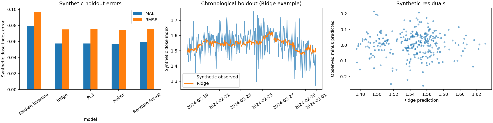

# Antiscalant Dosage — Data & Machine Learning Portfolio

This repository presents a public portfolio version of a Data & Machine Learning project carried out during an industrial internship.

The original industrial data cannot be shared for confidentiality reasons, so this repository uses only synthetic data to demonstrate the main methodology and modeling workflow.

## Project context and scope

The project focused on the analysis and prediction of historical antiscalant dosage in an industrial desalination process.

The work included:

- preparation and cleaning of process-control and laboratory data;
- temporal alignment of data collected at different frequencies;
- data quality checks;
- feature engineering;
- regression modeling;
- comparison of Machine Learning models against a simple baseline;
- evaluation using MAE, RMSE and R².

The models explored included Ridge Regression, Partial Least Squares (PLS), Huber Regression and Random Forest.

This repository provides a synthetic reconstruction of the methodology used during the internship and serves as a portfolio version of the project.

It does not contain the original internship code, industrial dataset, internal filenames, operating limits or confidential industrial results.

## What this demonstration does

1. Generates synthetic hourly process data and synthetic laboratory observations.
2. Performs basic data quality checks and removes duplicate timestamps.
3. Aligns process and laboratory data using temporal information.
4. Creates features from available observations, including a rolling mean based only on past observations.
5. Uses a chronological train/test split to respect the temporal nature of the data.
6. Trains and compares several regression models.
7. Evaluates the models using MAE, RMSE and R².
8. Generates visualizations for model comparison, predictions and residual analysis.

The parameters and synthetic signals used here are illustrative and do not reproduce the original industrial dataset.

## Technologies

- Python
- Pandas
- NumPy
- Scikit-learn
- Matplotlib
- Jupyter Notebook

## Reproduce the project

Python 3.9–3.12 is recommended.

```bash
python3 -m venv .venv
source .venv/bin/activate

# Windows
# .venv\Scripts\activate

python -m pip install -r requirements.txt
python -m src.run_demo
python -m unittest discover -s tests
jupyter lab notebooks/01_synthetic_demo.ipynb
```

## Repository structure

```text
data/synthetic/    Synthetic process and laboratory data
notebooks/        01_synthetic_demo.ipynb
src/
    synthetic.py
    preprocessing.py
    features.py
    modeling.py
    plots.py
    run_demo.py
reports/          Synthetic metrics, predictions and evaluation plots
tests/            Pipeline and leakage checks
requirements.txt
```

## Synthetic data

All numerical signals used in this public repository are fictional and dimensionless.

| Column | Description |
|---|---|
| `timestamp` | Prediction timestamp |
| `flow_index` | Synthetic flow indicator |
| `temperature_index` | Synthetic temperature indicator |
| `dose_index` | Synthetic regression target |
| `available_at` | Laboratory result availability time |
| `salinity_index` | Synthetic laboratory indicator |
| `lab_age_hours` | Age of the latest available laboratory observation |
| `flow_previous_6h` | Mean flow over the previous six observations |
| `salinity_flow_interaction` | Interaction between synthetic salinity and flow |

## Results

The repository compares several regression approaches with a median baseline.

- [View model metrics](reports/synthetic_metrics.csv)
- [View holdout predictions](reports/synthetic_predictions.csv)



These results are based entirely on synthetic data and are intended to demonstrate the Machine Learning workflow rather than reproduce industrial performance.

## Confidentiality

No original industrial datasets, reports, screenshots, internal identifiers or confidential operating information are included in this repository.

The synthetic dataset and public code provide a safe and reproducible demonstration of the methodology.
